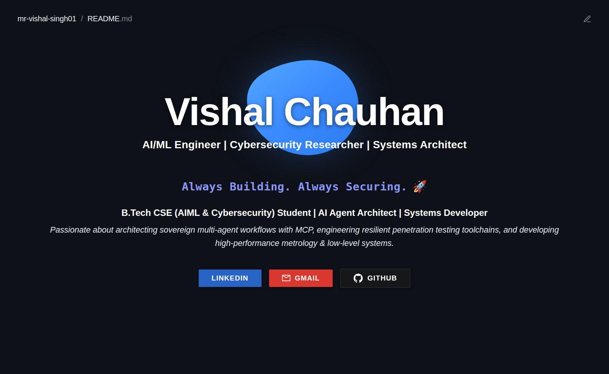

  

  

  
<i>⚡ "Architecting sovereign, autonomous AI workflows and engineering battle-tested cybersecurity defenses." 🛡️</i>

  
<b>B.Tech CSE (AIML & Cybersecurity) • Krishna Group of Institutions (AKTU) • SIH 2026 Architect</b>

  
Passionate about bridging autonomous multi-agent systems with industrial penetration testing, sovereign metrology pipelines, and low-level C systems.

  
  
  
  
  
  

 

<!-- ABOUT_ME_START -->
## 🧑‍💻 About Me

<table width="100%" border="0" cellspacing="0" cellpadding="0">
  <tr>
    <td width="32%" align="center" valign="top">
      
        
      
        
      
        
      
        
      
    </td>
    <td width="68%" valign="top" style="padding-left: 20px;">
      <h3>💻 <code>$ whoami</code></h3>
      <h2><b>Vishal Chauhan</b></h2>
      
<b>B.Tech in Computer Science & Engineering (AIML & CyberSec) • 2024–2028</b>

      <ul>
        <li>🎓 <b>University & College:</b> Krishna Group of Institutions (AKTU)</li>
        <li>📊 <b>Specialization:</b> Artificial Intelligence, Machine Learning & Cybersecurity</li>
        <li>📍 <b>Location:</b> Kanpur, Uttar Pradesh, India 🇮🇳</li>
        <li>🏆 <b>National Recognition:</b> <b>Smart India Hackathon 2026 Architect (SIH26035)</b> — Sovereign OIML R-76 Guided Metrology Testing Suite & PTB DCC XML</li>
        <li>💼 <b>Core Research:</b> Autonomous Multi-Agent Systems, Model Context Protocol (MCP), Local LLM Orchestration</li>
        <li>🛡️ <b>Cybersecurity:</b> Industrial Penetration Testing, WPA2/WPA3 Wireless Auditing, Exploit Defense</li>
        <li>⚡ <b>Systems Engineering:</b> High-performance C binary file persistence, Linux Kernel & Systemd Hardening</li>
        <li>🟢 <b>Availability:</b> Open to Summer Internships, Research Collaborations, and Open-Source Initiatives</li>
        <li>🎯 <b>Primary Focus:</b> Autonomous AI Agents • Industrial Pentesting Toolchains • Metrology Software</li>
        <li>📚 <b>Relevant Coursework:</b> DSA, Machine Learning, Deep Learning, DBMS, OS, Computer Networks, Cryptography</li>
      </ul>
      <blockquote>
        <i>"Building sovereign, privacy-preserving AI systems and engineering resilient security architectures for next-generation computing."</i>
      </blockquote>
      

        I design and build local-first autonomous agent ecosystems using the <b>Model Context Protocol (MCP)</b>, bridging LLMs with industrial penetration testing tools, automated metrology validation pipelines, and secure low-level systems.
      

    </td>
  </tr>
</table>
<!-- ABOUT_ME_END -->

 

---

## 🏛️ Digital Garden & Knowledge Repository

> [!IMPORTANT]
> **<a href="https://github.com/mr-vishal-singh01/mr-vishal-singh01/wiki">EXPLORE THE FULL KNOWLEDGE BASE</a>**
>   
>  
>   
> This ecosystem serves as an evolving **Digital Garden**, centralizing my architectural research, technical methodologies, and intellectual property across the AI and Cybersecurity domains.

### 🧭 Strategic Wiki Navigation

| 📘 <a href="https://github.com/mr-vishal-singh01/mr-vishal-singh01/wiki">**Knowledge Home**</a> | 👤 <a href="https://github.com/mr-vishal-singh01/mr-vishal-singh01/wiki/About-Me">**Identity & Bio**</a> | 🛡️ <a href="https://github.com/mr-vishal-singh01/mr-vishal-singh01/wiki/Technical-Skills">**Technical Skills**</a> |
| :---: | :---: | :---: |
| 🚀 <a href="https://github.com/mr-vishal-singh01/mr-vishal-singh01/wiki/Projects">**Active Projects**</a> | 💼 <a href="https://github.com/mr-vishal-singh01/mr-vishal-singh01/wiki/Experience">**Career Roadmap**</a> | 📚 <a href="https://github.com/mr-vishal-singh01/mr-vishal-singh01/wiki/Learning-Resources">**Learning Labs**</a> |
| ⚙️ <a href="https://github.com/mr-vishal-singh01/mr-vishal-singh01/wiki/Tech-Stack">**Full Tech Stack**</a> | 🌟 <a href="https://github.com/mr-vishal-singh01/mr-vishal-singh01/wiki/Open-Source">**Open Initiatives**</a> | 📫 <a href="https://github.com/mr-vishal-singh01/mr-vishal-singh01/wiki/Contact-Social">**Contact Hub**</a> |

---

## 🌟 Core Technical Pillars

<table width="100%">
  <tr>
    <td width="33%" valign="top">
      <h3 align="center">🤖 Autonomous AI & Agents</h3>
      

        
        
        
      

      

        Architecting stateful <b>ReAct agents</b> and local-first orchestrators. Specialized in bridging LLMs with real-world toolchains via the <b>Model Context Protocol (MCP)</b> for autonomous, privacy-centric reasoning and secure tool execution on consumer hardware.
      

    </td>
    <td width="33%" valign="top">
      <h3 align="center">🛡️ Offensive & Defensive Security</h3>
      

        
        
        
      

      

        Conducting hands-on penetration testing, exploit validation, and wireless protocol auditing (WPA2/WPA3). Researching automated vulnerability assessment, network traffic dissection, and secure-by-default architecture design.
      

    </td>
    <td width="33%" valign="top">
      <h3 align="center">⚙️ Systems & Metrology</h3>
      

        
        
        
      

      

        Engineering high-reliability software architectures. Developed sovereign OIML R-76 metrology verification pipelines with ISO 19005-3 PDF/A-3 and PTB DCC v3.2.1 XML for Smart India Hackathon (SIH 2026), alongside low-level binary data storage engines.
      

    </td>
  </tr>
</table>

---

## 💻 Featured Engineering Projects

<!-- PROJECTS_START -->
<table>
  <tr>
    <td width="50%" valign="top">
      <h3 align="center">⚖️ OIML NAWI Metrology Tester R-76</h3>
      

        
        
        
      

      
🇮🇳 Sovereign OIML R-76 Guided Non-Automatic Weighing Instruments (NAWI) testing suite engineered for <b>Smart India Hackathon 2026</b>. Features automated accuracy/repeatability tests, ISO 19005-3 PDF/A-3 generation, PTB Digital Calibration Certificate (DCC v3.2.1) XML export, and Ed25519 cryptographic signing.

      

        
      

    </td>
    <td width="50%" valign="top">
      <h3 align="center">🤖 Ollama MCP Orchestrator</h3>
      

        
        
        
      

      
An advanced Python orchestrator connecting local Ollama models with 200+ Model Context Protocol (MCP) servers. Enables autonomous cybersecurity reasoning, automated penetration testing tool-chaining, hardware-aware resource optimization, and private offline execution.

      

        
      

    </td>
  </tr>
  <tr>
    <td width="50%" valign="top">
      <h3 align="center">🛡️ BTech Pentesting Labs</h3>
      

        
        
        
      

      
A rigorous collection of offensive security research and penetration testing labs conducted during my B.Tech studies. Covers network vulnerability analysis, CVE reproduction, privilege escalation, and security hardening methodologies.

      

        
      

    </td>
    <td width="50%" valign="top">
      <h3 align="center">📡 Wireless Security Analysis</h3>
      

        
        
        
      

      
Applied research and auditing suite for evaluating IEEE 802.11 wireless infrastructures. Explores four-way handshake inspection, rogue AP detection, deauthentication defense mechanisms, and SAE (WPA3-Personal) security analysis.

      

        
      

    </td>
  </tr>
  <tr>
    <td width="50%" valign="top">
      <h3 align="center">🤝 Open Claude Co-Work</h3>
      

        
        
        
      

      
An open-source collaboration framework designed to integrate autonomous AI co-working capabilities directly into local developer environments with 500+ SaaS application integrations.

      

        
      

    </td>
    <td width="50%" valign="top">
      <h3 align="center">🛠️ Student Management System</h3>
      

        
        
        
      

      
A high-performance C system for academic record management. Built with direct binary file persistence, atomic CRUD operations across 14 record fields, and memory-efficient search indexing without external database dependencies.

      

        
      

    </td>
  </tr>
</table>
<!-- PROJECTS_END -->

   
  
  

---

## 🛠️ Tech Stack & Engineering Arsenal

| Domain | Core Technologies & Tools |
| :--- | :--- |
| **Languages** |      |
| **AI / Agentic Frameworks** |      |
| **Cybersecurity & Pentesting** |      |
| **Systems & Infrastructure** |      |

 

**📖 <a href="https://github.com/mr-vishal-singh01/mr-vishal-singh01/wiki/Tech-Stack">View In-Depth Technical Breakdown in Wiki</a>**

---

## 📊 GitHub Activity & Real-Time Metrics

  
  
  

 

  
  

   
  

---

## 🧠 Institutional Knowledge & Documentation

This repository serves as a centralized **Knowledge Base**, hosting comprehensive documentation on my technical journey, architectural methodologies, and research findings.

| Knowledge Domain | Documentation Scope | Wiki Link |
| :--- | :--- | :--- |
| **🏆 Professional Journey** | Career milestones, educational background, and core mission | [**Read Bio**](https://github.com/mr-vishal-singh01/mr-vishal-singh01/wiki/About-Me) |
| **🛡️ Technical Specializations** | In-depth breakdown of AI, Cybersecurity, and Systems skills | [**View Skills**](https://github.com/mr-vishal-singh01/mr-vishal-singh01/wiki/Technical-Skills) |
| **🚀 Project Architecture** | Comprehensive technical deep-dives into all developed ecosystems | [**Deep Dives**](https://github.com/mr-vishal-singh01/mr-vishal-singh01/wiki/Projects) |
| **📚 Learning Frameworks** | Curated educational resources and advanced research materials | [**Learning Labs**](https://github.com/mr-vishal-singh01/mr-vishal-singh01/wiki/Learning-Resources) |
| **🛠️ Tech Stack Analysis** | Detailed analysis of tools, languages, and infrastructure choices | [**Tech Stack**](https://github.com/mr-vishal-singh01/mr-vishal-singh01/wiki/Tech-Stack) |
| **🌐 Open Source Ethos** | Philosophy on community contribution and collaborative innovation | [**Open Source**](https://github.com/mr-vishal-singh01/mr-vishal-singh01/wiki/Open-Source) |

 

**🚀 <a href="https://github.com/mr-vishal-singh01/mr-vishal-singh01/wiki">ACCESS THE FULL PROFESSIONAL WIKI</a>**

---

## 🔗 Connectivity Hub

| Destination | Primary Function | Access Link |
| :--- | :--- | :--- |
| **📘 Professional Wiki** | Comprehensive documentation of research & architecture | [**Explore Knowledge Base**](https://github.com/mr-vishal-singh01/mr-vishal-singh01/wiki) |
| **💼 LinkedIn Network** | Professional connections & career milestones | [**Connect on LinkedIn**](https://linkedin.com/in/vishal-chauhan-620283378) |
| **✍️ Technical Writing** | Deep dives into AI, Cybersecurity, & Systems Engineering | [**Read Articles on Medium**](https://medium.com/@Mrvishalsinghchauhan) |
| **📂 Project Portfolio** | Source code, technical demos, and experimental research | [**Browse Repositories**](https://github.com/mr-vishal-singh01) |
| **🐦 X (Twitter)** | Real-time tech updates, AI insights, and cybersecurity discussions | [**Follow @Vishalchauchn01**](https://twitter.com/Vishalchauchn01) |
| **✉️ Direct Inquiries** | Collaboration, research opportunities, & professional outreach | [**Send Email**](mailto:mrvishalsinghchauhan01@gmail.com) |

---

## 🤝 Strategic Engagement & Collaboration

I am always open to discussing technical challenges, research initiatives, and innovative partnerships:

- **🤖 Research Partnerships:** Collaborating on autonomous AI agents and AI-driven offensive/defensive security frameworks.
- **🛠️ Open Source Contribution:** Driving the evolution of the **Model Context Protocol (MCP)** and agentic ecosystems together.
- **📚 Knowledge Exchange:** Engaging in technical mentorship, security research projects, and community-driven innovation.
- **🎯 Strategic Inquiries:** Discussing complex architectural challenges, system design, or potential project collaborations.

**📖 <a href="https://github.com/mr-vishal-singh01/mr-vishal-singh01/wiki/Contact-Social">Visit the Contact & Engagement Wiki</a>** for a detailed guide on how to connect and collaborate.

---

## 📜 Governance & Project Policies

To maintain high standards of transparency and engineering excellence, the following policies apply to all repositories in this ecosystem:

- **🛡️ [Security Policy](https://github.com/mr-vishal-singh01/mr-vishal-singh01/blob/main/SECURITY.md):** Guidelines for responsible disclosure and vulnerability reporting.
- **💎 [Quality Standards](https://github.com/mr-vishal-singh01/mr-vishal-singh01/blob/main/quality.md):** Detailed engineering conventions, testing rigor, and QA protocols.

---

  
<i><b>Engineering secure, autonomous systems for the next generation of computing.</b></i>

  
    
  
Explore the <strong><a href="https://github.com/mr-vishal-singh01/mr-vishal-singh01/wiki">Professional Knowledge Base</a></strong> for architectural deep-dives.

